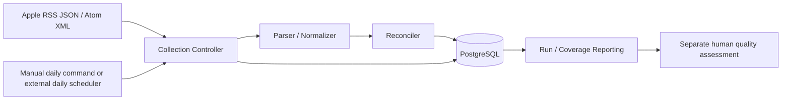
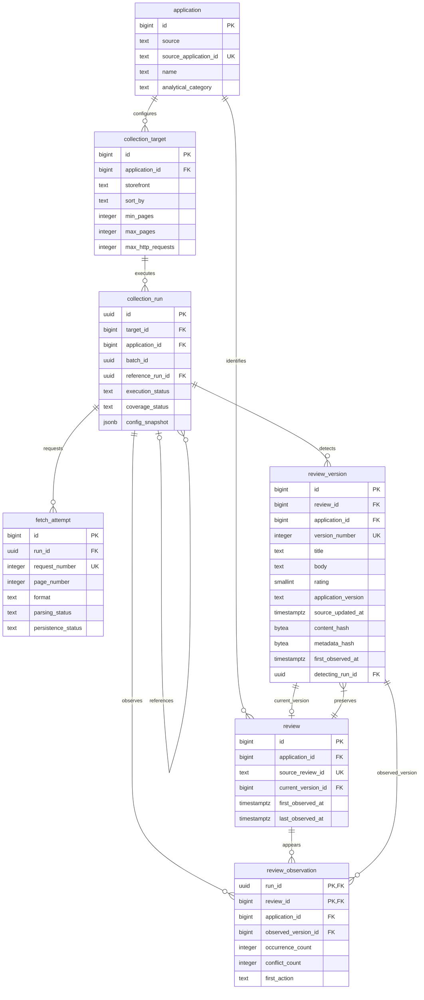
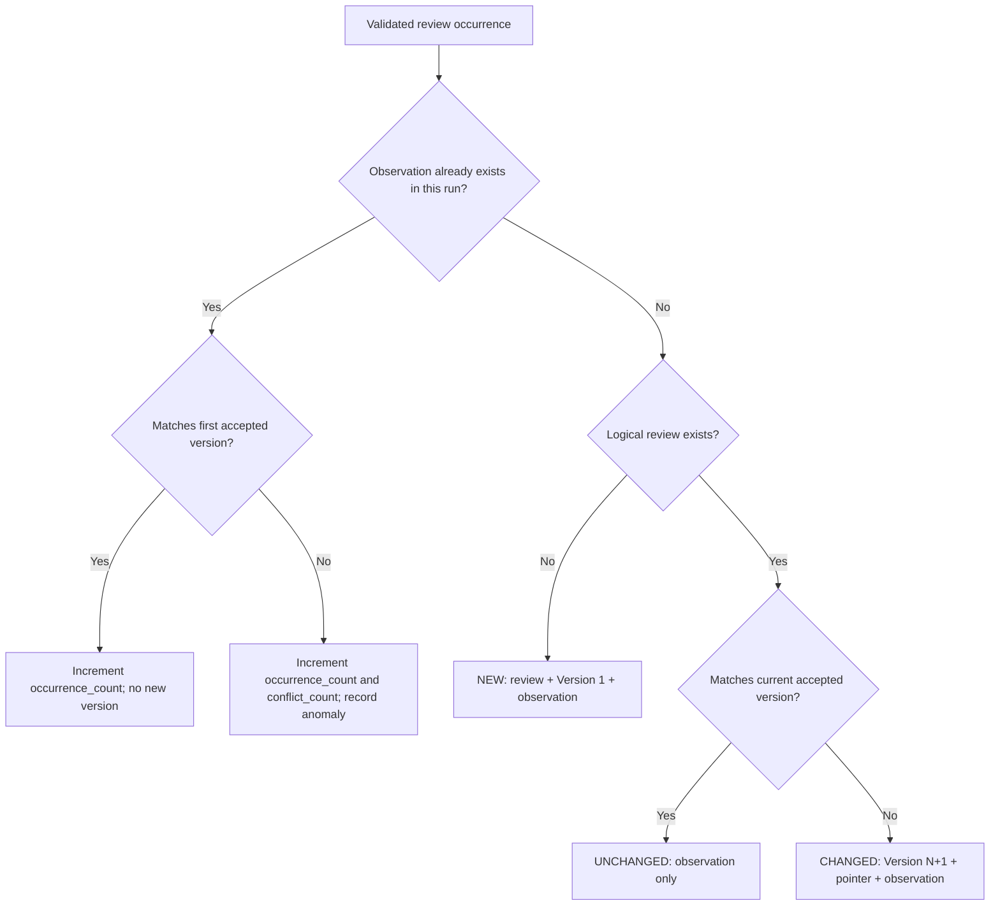

# Phase I — Apple App Store Ingestion Pilot: System Design

**Design date:** November 3, 2026 (America/Los_Angeles).  
**Status:** Approved core design. The later operational-boundary correction removes software approval gates; actual live execution remains disabled.  

**Operational-boundary correction:** the collector validates technical scope, explicit enablement, validity and engineering limits. Project access/data-use and retention applicability are documented for project-level review; no approval Boolean, approval document or administrative reference is required by the current execution path. This clarification changes no table, reconciliation, reference-selection or stopping semantics. Original phase-authorization statements below describe their historical design task.
**Deliverable boundary:** Design only. No production code, migrations, live requests, historical-evidence changes, commits or pushes are part of this task.

## 1. Objectives, decisions and evidence

Build a small, deterministic ingestion system that observes Apple RSS review windows, stores full review text and observed versions in PostgreSQL, and reports execution and coverage separately. Support subsequent human content-quality assessment. This phase does not train models or implement automated sentiment analysis.

The approved source selection identifies Apple as the primary technical candidate, Google Play as backup and Steam as technical baseline. Source selection is settled for this design. Do not reopen the search, add applications, change storefronts or integrate the backup source.

### 1.1 Confirmed requirements versus proposed details

The implementation scope specifies Python, SQLAlchemy, Alembic, PostgreSQL, seven core tables, page-level transactions, full-text version retention, per-run observations, bounded pagination, eight applications, US storefront, approximately daily collection, seven calendar days of validation, and separate human assessment. No Kafka, Redis, Celery, Airflow, services or LLM dependency is needed.

The architecture, seven-table schema, ownership constraints, page-level transactions, reconciliation, full-text version storage and human assessment protocol are approved as the design baseline. First-committed-snapshot conflict handling and the operational defaults of ten requests, zero automatic retries, global spacing, bounded timeouts and JSON/XML fallback are also approved. This revision implements the requested separation of comparison-reference eligibility from coverage sufficiency, a 72-hour age warning and low-volume reporting reasons. Settings remain configurable and frozen per run. Section 15 distinguishes remaining live-use blockers from routine implementation choices. The SQL below is a schema specification embedded in documentation, not a generated migration or a deployed schema.

### 1.2 Repository compatibility and limits

Reviewed inputs:

| Input | Design consequence |
| --- | --- |
| [Root README](../README.md), [source recommendation](../results/source_recommendation.md) | Preserve source ordering and distinguish feasibility from production acceptance. |
| Original four-page Project Brief, held separately in the adjacent research workspace | Modular acquisition, cleaning/loading, relational storage and health verification are the foundation; downstream labeling/training is context, not authorization to implement it in this pilot. |
| [Mobile comparison](../results/mobile_review_comparison.md), [earlier acquisition assessment](../results/mainstream_review_assessment.md), [evidence index/methodology](../research/current_evidence.md) | Preserve dated evidence, format variability, unresolved freshness and use conditions. |
| [App manifest](../results/mainstream/app_sample_manifest.json) | Seed exactly the eight identities below. The manifest's historical `reviews_collected: 0` is not a current ingestion counter. |
| [RSS diagnostic](../src/feasibility/apple_validation.py) | Reuse Atom namespaces, JSON envelope validation and title/body/rating/version/updated field mappings where practical. |
| [Mobile probe](../probes/mobile_quality.py) | Reuse observed JSON/Atom equivalence and ID linkage concept, not global session state, import-time evidence loading, five-record sampling or hard-coded per-app format rules. This projection currently omits title. |
| [HTTP utility](../src/feasibility/http.py) | Preserve HTTPS/host checking, no ambient credentials, no redirects, bounded streaming, timeouts and sanitized error codes. It currently decodes JSON directly; the pilot needs a byte-response adapter for both formats. |
| [Apple tests](../tests/test_apple_validation.py), [mobile tests](../tests/test_mobile_quality.py), [package configuration](../pyproject.toml) | Preserve existing tests and no-body diagnostic assertions. Current dependencies contain requests, not SQLAlchemy/Alembic/a PostgreSQL driver. Add those only during approved implementation. |

The original four-page Project Brief was read from `../data-ingestion-research/Project_Kickoff/Data Ingestion System - Project Brief.pdf` without copying its internal contents into this public-facing design. The design narrows that broader foundation to the Apple pilot with PostgreSQL. The Brief's discussion of future sources, users, labeling and model integration does not require extra tables, source expansion or model work here.

The existing comparison reports 16/16 Apple requests and approximately four-minute repeats, with no newly visible IDs or edits in those repeats. These historical findings do not establish day-scale continuity, stable IDs after edits, or edit ordering. The existing usefulness labels were AI-assisted, not independent human assessment. This design produces no new source evidence and no seven-day observations.

### 1.3 Fixed sampling frame

All targets use `source = apple_app_store`, `storefront = us`, `sort_by = mostrecent`. Application IDs and review IDs are opaque strings; numeric-looking values are not integers in the data model.

| Analytical category | Application name from manifest | Apple application ID |
| --- | --- | --- |
| productivity | Todoist: To Do List & Calendar | `572688855` |
| productivity | Microsoft To Do | `1212616790` |
| education | Duolingo: Learn Languages | `570060128` |
| education | Khan Academy | `469863705` |
| shopping | Amazon Shopping | `297606951` |
| shopping | Etsy: Shop from Real People | `477128284` |
| transportation | Uber - Rides, Eats, Hotels | `368677368` |
| transportation | Lyft | `529379082` |

These are analytical categories, not an assertion that every review concerns app functionality. Transport/service/delivery experiences remain in scope. Amazon Shopping app reviews are not ASIN-level product reviews. The sample is purposive, not representative of consumers or the entire App Store.

## 2. Architecture and component contracts



One Python process handles a batch sequentially across eight targets. A manual CLI is sufficient initially; a later OS scheduler invokes the same command. Batch UUID groups runs without an eighth batch table. Missed schedules are reported, not silently backfilled with multiple immediate calls. No long-lived worker framework is required.

| Component | Input → output | Responsibility |
| --- | --- | --- |
| Controller | Target + frozen configuration → run, bounded requests, stop reason | Locks, eligibility, budgets, fallback, lifecycle and coverage decisions. |
| Transport | Validated page/format → in-memory bytes + safe request metadata | One actual request per fetch attempt; never writes response bodies. |
| Parser/normalizer | Bytes + format + versioned contract → ordered validated records | Complete title/body, opaque ID, rating and optional metadata; distinguish missing entries from invalid schema. |
| Reconciler | Validated logical page + run → atomic identity/version/observation updates | Deterministic state machine, locking and conflict recording. No HTTP. |
| Reporting | Committed database state → sanitized JSON/CSV or console report | Derived counts, overlap, coverage and anomalies. No review text in routine diagnostics. |
| Human protocol | Authorized private full-text sample → human labels | Separate artifact with provenance; no automatic human labels. |

Proposed future package: `src/feasibility/apple_ingestion/` with `controller`, `transport`, `parser`, `reconcile`, `models`, `reporting`, `cli`, plus Alembic scripts in a separate migration directory. Existing probes retain their historical purpose and output shapes. Do not import the mobile probe as a runtime library because it reads historical artifacts and initializes globals at import time. Extract or adapt pure parsing functions under tests during implementation.

## 3. Data model and ER diagram

Seven core tables only. Additional relational columns carry ownership for composite foreign keys; they do not duplicate mutable review content. Diagnostics use bounded structured JSON on attempts/runs, not an occurrence or anomaly table.



An existing review has at least one version at commit. `review.current_version_id` is mandatory and belongs to that same review. A version can be current for at most its own parent. ER attribute lists are abbreviated; the normative complete schema follows.

## 4. PostgreSQL schema specification

Use a supported PostgreSQL release chosen and pinned at implementation; PostgreSQL 15+ is the proposed minimum. Use SQLAlchemy 2.x sessions and Alembic to express this specification after approval. UUIDs are generated in Python. UTC-aware Python datetimes map to `timestamptz`; connections use `SET TIME ZONE 'UTC'`. PostgreSQL stores instants, not the original timezone spelling. Never accept a naive timestamp as UTC without an explicit parsing rule.

### 4.1 Tables, checks, keys and indexes

```sql
CREATE TABLE application (
    id bigint GENERATED BY DEFAULT AS IDENTITY PRIMARY KEY,
    source text NOT NULL CHECK (source = 'apple_app_store'),
    source_application_id text NOT NULL CHECK (length(source_application_id) > 0),
    name text NOT NULL CHECK (length(name) > 0),
    analytical_category text NOT NULL CHECK (analytical_category IN
        ('productivity', 'education', 'shopping', 'transportation')),
    UNIQUE (source, source_application_id)
);

CREATE TABLE collection_target (
    id bigint GENERATED BY DEFAULT AS IDENTITY PRIMARY KEY,
    application_id bigint NOT NULL REFERENCES application(id),
    storefront text NOT NULL CHECK (storefront = 'us'),
    sort_by text NOT NULL CHECK (sort_by = 'mostrecent'),
    enabled boolean NOT NULL DEFAULT false,
    interval_hours integer NOT NULL DEFAULT 24 CHECK (interval_hours > 0),
    min_pages integer NOT NULL DEFAULT 2 CHECK (min_pages >= 1),
    max_pages integer NOT NULL DEFAULT 5 CHECK (max_pages >= min_pages),
    min_overlap_count integer NOT NULL DEFAULT 20 CHECK (min_overlap_count >= 0),
    min_overlap_ratio numeric(6,5) NOT NULL DEFAULT 0.20
        CHECK (min_overlap_ratio BETWEEN 0 AND 1),
    max_http_requests integer NOT NULL DEFAULT 10 CHECK (max_http_requests > 0),
    reference_max_age_hours integer NOT NULL DEFAULT 72 CHECK (reference_max_age_hours > 0),
    UNIQUE (application_id, storefront, sort_by),
    UNIQUE (id, application_id)
);

CREATE TABLE collection_run (
    id uuid PRIMARY KEY,
    target_id bigint NOT NULL,
    application_id bigint NOT NULL,
    batch_id uuid NOT NULL,
    started_at timestamptz NOT NULL,
    finished_at timestamptz,
    execution_status text NOT NULL CHECK (execution_status IN
        ('running', 'succeeded', 'partial', 'failed', 'interrupted')),
    coverage_status text NOT NULL CHECK (coverage_status IN
        ('pending', 'baseline', 'overlap_sufficient', 'overlap_insufficient',
         'no_reference', 'empty_window', 'indeterminate')),
    reference_run_id uuid,
    stop_reason text,
    config_snapshot jsonb NOT NULL CHECK (jsonb_typeof(config_snapshot) = 'object'),
    anomalies jsonb NOT NULL DEFAULT '[]'::jsonb CHECK (jsonb_typeof(anomalies) = 'array'),
    FOREIGN KEY (target_id, application_id)
        REFERENCES collection_target(id, application_id),
    UNIQUE (id, application_id),
    UNIQUE (id, target_id, application_id),
    FOREIGN KEY (reference_run_id, target_id, application_id)
        REFERENCES collection_run(id, target_id, application_id),
    CHECK (reference_run_id IS NULL OR reference_run_id <> id),
    CHECK (finished_at IS NULL OR finished_at >= started_at),
    CHECK ((execution_status = 'running' AND finished_at IS NULL AND stop_reason IS NULL)
        OR (execution_status <> 'running' AND finished_at IS NOT NULL AND stop_reason IS NOT NULL)),
    CHECK (execution_status <> 'running' OR coverage_status = 'pending')
);

CREATE UNIQUE INDEX one_running_run_per_target
    ON collection_run(target_id) WHERE execution_status = 'running';
CREATE INDEX collection_run_reference_lookup ON collection_run(target_id, started_at DESC);
CREATE INDEX collection_run_batch_lookup ON collection_run(batch_id);

CREATE TABLE fetch_attempt (
    id bigint GENERATED BY DEFAULT AS IDENTITY PRIMARY KEY,
    run_id uuid NOT NULL REFERENCES collection_run(id),
    request_number integer NOT NULL CHECK (request_number > 0),
    page_number integer NOT NULL CHECK (page_number > 0),
    format text NOT NULL CHECK (format IN ('json', 'xml')),
    attempt_number integer NOT NULL CHECK (attempt_number > 0),
    started_at timestamptz NOT NULL,
    finished_at timestamptz,
    http_status smallint CHECK (http_status BETWEEN 100 AND 599),
    parsing_status text NOT NULL CHECK (parsing_status IN
        ('pending', 'not_attempted', 'succeeded', 'failed')),
    persistence_status text NOT NULL CHECK (persistence_status IN
        ('pending', 'not_applicable', 'committed', 'rolled_back', 'unknown')),
    entry_count integer CHECK (entry_count >= 0),
    response_bytes integer CHECK (response_bytes >= 0),
    error_codes jsonb NOT NULL DEFAULT '[]'::jsonb CHECK (jsonb_typeof(error_codes) = 'array'),
    anomalies jsonb NOT NULL DEFAULT '[]'::jsonb CHECK (jsonb_typeof(anomalies) = 'array'),
    UNIQUE (run_id, request_number),
    UNIQUE (run_id, page_number, format, attempt_number),
    CHECK (finished_at IS NULL OR finished_at >= started_at),
    CHECK (parsing_status <> 'succeeded' OR entry_count IS NOT NULL),
    CHECK (persistence_status <> 'committed' OR parsing_status = 'succeeded')
);

-- JSON missing entries can produce a succeeded parse but not_applicable persistence:
-- XML is the selected logical-page response in that case.
CREATE UNIQUE INDEX one_committed_response_per_page
    ON fetch_attempt(run_id, page_number) WHERE persistence_status = 'committed';

CREATE TABLE review (
    id bigint GENERATED BY DEFAULT AS IDENTITY PRIMARY KEY,
    application_id bigint NOT NULL REFERENCES application(id),
    source_review_id text NOT NULL CHECK (length(source_review_id) > 0),
    current_version_id bigint NOT NULL,
    first_observed_at timestamptz NOT NULL,
    last_observed_at timestamptz NOT NULL,
    UNIQUE (application_id, source_review_id),
    UNIQUE (id, application_id),
    CHECK (last_observed_at >= first_observed_at)
);

CREATE TABLE review_version (
    id bigint GENERATED BY DEFAULT AS IDENTITY PRIMARY KEY,
    review_id bigint NOT NULL,
    application_id bigint NOT NULL,
    version_number integer NOT NULL CHECK (version_number > 0),
    title text,
    body text NOT NULL,
    rating smallint NOT NULL CHECK (rating BETWEEN 1 AND 5),
    application_version text,
    source_updated_at timestamptz,
    content_hash bytea NOT NULL CHECK (octet_length(content_hash) = 32),
    metadata_hash bytea NOT NULL CHECK (octet_length(metadata_hash) = 32),
    first_observed_at timestamptz NOT NULL,
    detecting_run_id uuid NOT NULL,
    FOREIGN KEY (review_id, application_id) REFERENCES review(id, application_id),
    FOREIGN KEY (detecting_run_id, application_id) REFERENCES collection_run(id, application_id),
    UNIQUE (review_id, version_number),
    UNIQUE (review_id, id)
);

ALTER TABLE review ADD CONSTRAINT current_version_belongs_to_review
    FOREIGN KEY (id, current_version_id) REFERENCES review_version(review_id, id)
    DEFERRABLE INITIALLY DEFERRED;

CREATE TABLE review_observation (
    run_id uuid NOT NULL,
    review_id bigint NOT NULL,
    application_id bigint NOT NULL,
    observed_version_id bigint NOT NULL,
    first_observed_at timestamptz NOT NULL,
    first_observed_page integer NOT NULL CHECK (first_observed_page > 0),
    first_observed_position integer NOT NULL CHECK (first_observed_position > 0),
    occurrence_count integer NOT NULL DEFAULT 1 CHECK (occurrence_count >= 1),
    conflict_count integer NOT NULL DEFAULT 0 CHECK (conflict_count >= 0),
    first_action text NOT NULL CHECK (first_action IN ('new', 'unchanged', 'changed')),
    PRIMARY KEY (run_id, review_id),
    FOREIGN KEY (run_id, application_id) REFERENCES collection_run(id, application_id),
    FOREIGN KEY (review_id, application_id) REFERENCES review(id, application_id),
    FOREIGN KEY (review_id, observed_version_id) REFERENCES review_version(review_id, id),
    CHECK (conflict_count < occurrence_count)
);

CREATE INDEX review_observation_review_history ON review_observation(review_id, run_id);
```

Primary/unique constraints create their own indexes; do not add duplicates. Composite uniqueness on parent IDs is required to express ownership FKs even where the scalar ID is already unique. These small extra indexes buy database-enforced ownership. Observation history needs the reverse index because its PK starts with `run_id`. Version history is served by `(review_id, version_number)`. Attempts are served by `(run_id, request_number)`. Do not add body, hash, JSONB GIN, timestamp or sentiment indexes without an actual query need. Full-text search is outside this pilot.

Default FK behavior restricts deleting referenced rows; there is no cascading content deletion. Identity-sequence gaps after rollback are expected. No unique fingerprint constraint is permitted: A → B → A must produce three observed versions.

### 4.2 Field semantics and non-DDL invariants

* `config_snapshot` freezes **all** effective settings: source/application identity, target/storefront/sort, limits, cadence, formats/fallback/retry policy, host/body/time limits, reference age, parser/hash-contract versions, software revision, run mode (`live` or `synthetic`), optional legacy-named access/retention reference fields. The project-policy ID and technical configuration digest provide run traceability; administrative documents/references are not mandatory. It contains no credentials or review text.
* On INSERT, validate the snapshot against a versioned configuration schema in Python before creating the run. A migration must install an update trigger rejecting changes to `config_snapshot`, target/application/batch identity, `reference_run_id` and `started_at`. Select the reference before INSERT. A CHECK cannot compare old/new values; JSONB alone does **not** enforce immutability.
* Terminal runs and attempts are not repurposed or restarted. Lifecycle updates occur through the controller repository layer; completion checks reject a pending attempt or pending coverage at finalization. Recovery may finalize an orphaned running run. Corrections to terminal diagnostics require an explicit audited maintenance operation.
* `anomalies` stores bounded objects such as `{code, page, review_id, count, candidate_content_hash, candidate_metadata_hash}`. Use internal review IDs, safe hashes and enumerated codes; never body/title/author or arbitrary exceptions. Aggregate repeated events, cap detail at 100 objects per run/attempt and retain exact total counts plus `detail_truncated`. The conflicting alternate body is not a confirmed version and is discarded from memory after diagnostics.
* `entry_count` counts parsed review candidates, not Apple catalog entries and not distinct IDs. Null means not known; zero means a valid empty response. Distinguish absent `entry` from a present empty list using an anomaly code.
* `first_observed_at` is the request-completion instant of the accepted response, shared by its records; it is not source creation time. `last_observed_at` advances with `GREATEST` only after page commit, including repeated/conflicting sightings. First page/position use response order, 1-based, and never change later in the run.
* `body` is the complete parsed Unicode review body, without a 500-character limit or length screen. Empty string is allowed and remains assessable as U0/U1; missing/non-string body is invalid. `title`, app version and source update time may be null when absent. Null and empty string are distinct.
* `review_version` rows are append-only during normal ingestion. Give the ingestion role SELECT/INSERT on versions and the narrow UPDATE privileges needed elsewhere; do not grant version UPDATE/DELETE. Use a separate migration/maintenance role. Migrations must also install the snapshot-immutability trigger above. This is part of schema acceptance, not optional ORM behavior.
* DB constraints enforce cross-application ownership. Controller checks enforce reference eligibility, chronological reference selection, target snapshot compatibility and run lifecycle, which require querying other rows. Neither a self-FK nor a CHECK can alone establish reference eligibility.
* The existing `reference_max_age_hours` field is retained to preserve the approved schema. Despite its legacy name, it is an **age-warning threshold**, initially 72 hours, not a reference-selection cutoff. The snapshot records this interpretation as `reference_age_policy = warn_only`; age warnings use the existing structured run diagnostics and reports, with no new column or table.

The migration must include this database-level immutable-run guard, in addition to the table definitions:

```sql
CREATE FUNCTION guard_collection_run_identity() RETURNS trigger
LANGUAGE plpgsql AS $$
BEGIN
    IF ROW(NEW.id, NEW.target_id, NEW.application_id, NEW.batch_id,
           NEW.started_at, NEW.reference_run_id, NEW.config_snapshot)
       IS DISTINCT FROM
       ROW(OLD.id, OLD.target_id, OLD.application_id, OLD.batch_id,
           OLD.started_at, OLD.reference_run_id, OLD.config_snapshot) THEN
        RAISE EXCEPTION 'collection_run_identity_is_immutable' USING ERRCODE = '23514';
    END IF;
    RETURN NEW;
END;
$$;

CREATE TRIGGER collection_run_identity_is_immutable
    BEFORE UPDATE ON collection_run
    FOR EACH ROW EXECUTE FUNCTION guard_collection_run_identity();
```

Use deployment-specific role names in Alembic/operations configuration. The ingestion role is not the schema owner: grant SELECT/INSERT on the seven tables, sequence usage, UPDATE only on controller-managed run/attempt fields, review current-pointer/last-seen fields, and observation counters. Grant no application/target UPDATE to runtime, no version UPDATE/DELETE and no table DELETE. Configuration seeding/changes use the maintenance role. Restrict function/schema ownership to that role as well. Reports use a read-only role; full-text access follows the approved assessment scope.

### 4.3 Circular creation and ORM mapping

Within one transaction allocate a version ID with the identity sequence, insert the new review with that non-null `current_version_id`, insert Version 1 with the reserved ID, then insert the observation. The current-version FK is deferred until commit; the version-to-review FK is immediately satisfied. SQLAlchemy must explicitly order these operations using Core statements/flushes and a reserved sequence ID; do not rely on relationship autoflush to solve the cycle or temporarily commit null pointers. Alembic creates the six independent tables, the version table, then adds the circular FK; downgrade removes the circular FK first. ORM relationships must specify their foreign-key paths explicitly.

For existing reviews, lock the review row, read its current version, reserve and insert N+1 when needed, then update the pointer. Unique `(review_id, version_number)` and the owned pointer FK provide a final safety net. The writer enforces monotone N+1 and current = latest accepted version; ordinary SQL FK constraints do not themselves enforce those ordering rules. Verify these service invariants with real PostgreSQL tests and integrity queries.

## 5. Parsing, identity and deterministic versioning

### 5.1 Parsing and hash contract

Reuse JSON `feed` validation, dictionary-or-list entry handling and Atom namespaces. Ignore recognizable app/catalog entries without review-rating fields, but reject review-shaped entries with missing ID/body, invalid rating, malformed optional timestamp or invalid field types. A bad review candidate fails the entire page before any review changes. Do not silently skip malformed reviews and then claim adequate coverage. Disable XML external resource resolution and reject DTD/entity declarations; test nested XML/HTML cases explicitly.

JSON and Atom adapters return the same ordered record contract: `source_review_id`, nullable `title`, complete `body`, integer `rating`, nullable `application_version`, nullable aware `source_updated_at`. Preserve IDs exactly; do not convert them through floats/integers, trim them or extract a supposed numeric suffix. Reject empty or whitespace-only IDs and unsafe application IDs at URL construction. The numeric URL validation for these eight manifest app IDs is a transport restriction, not a database identity type.

Proposed hash contract `apple-observed-v1`:

1. Preserve complete decoded title/body and line breaks in storage. Transport-level JSON/XML escaping is decoded once by its parser; do not repeatedly HTML-unescape or collapse all whitespace for the stored body.
2. For comparison, normalize CRLF/CR to LF and Unicode to NFC. Otherwise preserve whitespace and literal characters. Distinguish null title from empty title. Do not translate, summarize, redact or lowercase the content before hashing.
3. `content_hash = SHA256(UTF8(canonical_JSON([title, body])))` after that comparison normalization.
4. `metadata_hash = SHA256(UTF8(canonical_JSON([rating, application_version, source_updated_at_UTC])))`; timestamps serialize in one fixed UTC ISO format, missing values as JSON null. Use fixed JSON separators, UTF-8 and no NaN; document test vectors.
5. Compare the normalized fields as well as hashes before declaring equality; hashes are accelerators and diagnostics, not a substitute for stored text. Two formats producing different canonical values are a conflict, not an opportunity to guess equivalence.

The old feasibility probe's whitespace-collapsed body hash is a **different contract**. Do not compare it as if it were the new two-hash version fingerprint or reconstruct full text from historical fingerprints. Parser/hash-contract changes require fixture equivalence review and an explicit transition; never silently rewrite old versions or manufacture edits through a normalization upgrade.

### 5.2 State machine



| Situation | Deterministic action |
| --- | --- |
| NEW | Create stable identity and V1, first/last timestamps and one observation. |
| UNCHANGED | Retain current version; create observation and advance last seen. |
| CHANGED, first occurrence in a later run | Accept a validated different fingerprint as a new **pipeline-observed snapshot**, N+1. A metadata-only difference also counts. Record detecting run; never claim proof of an Apple edit event. |
| INTRA_RUN_CONFLICT | Keep this run's first accepted snapshot and observed-version pointer. Count each occurrence, flag the observation and run, retain safe conflicting hashes on the attempt. Do not create another version from that run's alternate snapshot. |
| NOT_OBSERVED | No content/pointer/deletion update. Absence from the bounded feed is not deletion. |
| Historical fingerprint returns after another version | Create N+1 relative to the current accepted version; do not point back to or merge the old historical row. |

Within a page process occurrences in returned order, but acquire identity locks in sorted ID order to avoid deadlocks. Comparison for repeated IDs is always against the observation's accepted version, not whichever snapshot happens to be last on a page. Identical duplicates and conflicting duplicates both increment `occurrence_count`; `conflict_count` is the subset incompatible with the first snapshot. Observation uniqueness is `(run_id, review_id)` regardless of pages or formats.

### 5.3 Approved semantics: conflicts discovered after page commit

There is a real tension between immediate page commits and a requirement that a change be globally confirmed before acceptance: page 1 can commit a different snapshot before page 3 reveals a conflict. Retroactively erasing page 1 would violate the append-only observation record, while waiting until run end would replace the agreed page-level model.

**Approved rule:** Keep the first committed snapshot. “Confirmed change” means a valid first snapshot different from the preceding accepted snapshot, with no contradiction known at that page's commit. A later contradiction marks that run's observation **disputed** using `conflict_count > 0`. It does not create a second version or undo committed pages. The current pointer still means latest accepted observed snapshot, not an authoritative source state. Reporting separates `changed_observed` from `changed_undisputed`; a new independent run can confirm or supersede the snapshot. Consumers must join the detecting observation to see whether the version was disputed. Even an undisputed snapshot is not a verified reconstruction of Apple's history.

Conflicted runs are excluded from comparison-reference selection regardless of their raw ID overlap. This rule is settled for this pilot; no staging mechanism or run-end reversal is introduced.

Apple's review-ID stability following edits and the ordering of edited reviews remain unverified. No deterministic reconciliation algorithm can recover edits that never become visible, link a changed ID to an old author, or establish the completeness of Apple's edit history. Do not use author identity or text similarity to invent continuity.

## 6. Run lifecycle and reference selection

1. Validate fixed frame, run mode, explicit operational enablement, technical scope/window, snapshot schema, and limits. Access/data-use and retention applicability are project-management review items, not collector approval gates. Acquire the application lock before touching run state or issuing HTTP.
2. Finalize any genuinely abandoned running run under that lock (see recovery). Select a reference and create a `running/pending` run with UUID, batch UUID and frozen settings. A skipped locked target makes no request and is reported in the batch outcome; it need not create a run row.
3. Process page numbers sequentially from 1. Attempts exist before requests. After each committed logical page recompute cumulative metrics and the stop predicate.
4. Finalize execution, coverage, timestamps, anomalies and stop reason in one transaction. Release the lock in `finally`. A batch report shows all eight targets, including skipped, failed and missing targets.

### 6.1 Execution states

| State | Meaning |
| --- | --- |
| running | In progress, unfinished and coverage pending. |
| succeeded | Normal bounded stop; no unrecovered request, parse, persistence or consistency failure. Recovered JSON-empty/XML fallback is allowed. Empty windows or inadequate overlap can still be execution success. |
| partial | At least one logical page committed, then an unrecovered failure, blocking conflict/consistency anomaly, or incomplete fallback at request-budget exhaustion. |
| failed | No logical page committed and execution cannot complete normally. |
| interrupted | Process/session disappeared or operator interrupted it; committed pages remain valid evidence. Recovery records the last known state without assuming in-flight HTTP completion. |

No `succeeded` run has pending attempts. Codes distinguish `overlap_met`, `baseline_budget_complete`, `page_budget`, `request_budget`, `empty_window_budget`, `http_denied`, `transport_error`, `parse_error`, `db_error`, `consistency_anomaly`, `operator_interrupt`, `orphan_recovered`. Budget stops during an unresolved logical page produce partial/failed; stopping exactly between resolved pages can be succeeded with insufficient coverage.

### 6.2 Comparison-reference eligibility, independent of coverage

Choose the most recent **finished earlier** run for the same target/application with `execution_status = succeeded`, nonempty committed observations, resolved attempt states and no internal identity, parsing, persistence or consistency defects. Require the same run mode, storefront, sort, parser/hash contract and compatible interpretation of identities/windows. Select before creating the run and store its ID immutably. Missing eligibility produces null reference, never an empty set pretending to be a failed prior run.

**Do not filter candidates by their own coverage status, overlap count/ratio, minimum-page stopping predicate or age.** In particular, a valid `succeeded/overlap_insufficient` run becomes the next comparison reference. A low-volume window is usable comparison evidence. Coverage-only cautions such as valid empty pages or duplicate-only pages do not invalidate the reliable nonempty IDs on other committed pages; a successful, internally consistent run with those cautions may be a reference even when its coverage is `indeterminate`. Report those cautions alongside the comparison. Partial, failed, interrupted, malformed, conflicting, wholly empty, unresolved, incompatible or otherwise unusable runs remain excluded. A page/request budget stopping normally between resolved pages does not itself invalidate a candidate.

The proposed 72-hour interval is now an explicit warning threshold: measure reference age from its finish to current start and record `REFERENCE_AGE_WARNING` when age **exceeds** the snapshot threshold. Retain and use that reference. Exactly 72 hours does not trigger the warning. Show the actual elapsed time and continuity limitation; age neither sets `reference_run_id` to null nor independently changes execution status or the measured-overlap classification. Even adequate ID overlap across a long gap does not establish uninterrupted or complete collection.

Example: A establishes a baseline; B succeeds with insufficient overlap against A; C succeeds with insufficient overlap against B; D compares against C. Do not strand C/D against A or discard all references. If C is conflicted instead, D uses the most recent earlier eligible run (B), showing the larger interval and any warning.

### 6.3 Baseline and reference-chain restart

The first successful, nonempty, internally consistent run for this target/mode with no prior usable history establishes `baseline`. Without a reference it continues toward the bounded page/request limit; completing all five pages is not a reference-eligibility requirement. Empty or failed initial runs establish nothing. Coverage-only cautions still take priority as `indeterminate` in Section 8.3; the first usable anchor is nevertheless recorded in diagnostics and can be used by the next run. The term baseline means an initial observed window, not complete history or proven coverage.

When earlier usable history exists but none is comparison-compatible, collect within bounds and report `no_reference` (or the higher-priority failure/coverage caution), plus `REFERENCE_CHAIN_RESTARTED` and the excluded-candidate reasons. A successful, nonempty, internally consistent current run becomes the next usable anchor automatically, so the next compatible run can compare normally. Record this restart without rewriting prior statuses, dropping versions, changing thresholds or claiming continuity across the gap. An explicit operator-requested reset follows the same annotated behavior and records its reason in the immutable snapshot; it is not required merely because overlap was insufficient or the reference exceeded 72 hours.

The self-FK guarantees target/application membership, not eligibility. Reporting exposes comparison eligibility and exclusion reasons separately from coverage. No additional table or coverage status is required.

## 7. Fetch attempts, transactions, concurrency and recovery

### 7.1 One attempt per actual HTTP request

Before sending a request, insert and commit a fetch-attempt intent with the next `request_number`, page, format and per-page/format `attempt_number`. Intents reserve request budget; after a crash the system cannot always distinguish “sent but response lost” from “not yet sent”. Label such attempts `REQUEST_OUTCOME_UNKNOWN`, rather than fabricating an HTTP failure/success. Ordinary completed runs have one row per actual request; the crash uncertainty is retained explicitly.

Parsing and response bodies stay in memory. Complete an HTTP/parse diagnostic update in a short transaction before reconciling. The attempt can be `parsing_status = succeeded, persistence_status = pending` while reconciliation awaits commit. A fallback JSON response is completed as `not_applicable` because it was not selected as the logical page. XML, even when empty, is the selected page response. A failed request is `not_attempted/not_applicable` for parsing/persistence as appropriate; a parse failure is `failed/not_applicable`.

Do not log raw responses, SQL bound text, exception strings, authors or request cookies. Safe error codes include `HTTP_DENIED`, `HTTP_RATE_LIMIT`, `HTTP_NON_200`, `TRANSPORT_TIMEOUT`, `BODY_LIMIT`, `FEED_SCHEMA`, `ENTRY_SCHEMA`, `INVALID_TIMESTAMP`, `JSON_ENTRY_ABSENT`, `EMPTY_PAGE`, `INTRA_RUN_CONFLICT`, `PAGE_DUPLICATE_ONLY`, `DB_CONSTRAINT`, `DB_UNAVAILABLE`, `REQUEST_OUTCOME_UNKNOWN`, `DETAIL_TRUNCATED`. Database error diagnostics may include a whitelisted SQLSTATE, never SQL parameters.

### 7.2 Page-level atomic unit

After full-page validation, one SQLAlchemy transaction:

1. Lock the attempt row and verify it belongs to this run and is not committed. If already committed, return its committed result without replaying occurrence increments.
2. Lock existing review identities in a stable order. Reconcile all occurrences in memory order, inserting/updating review identities, versions and observations.
3. Update last-observation times, conflict counts and bounded attempt/run anomalies.
4. Mark the selected fetch attempt `persistence_status = committed` in **the same transaction**. Commit; only then count the logical page as processed.

If any statement fails, roll back all page changes and separately mark that attempt `rolled_back` with a safe error code. Earlier pages remain committed. A replay after an uncertain commit first reads the durable attempt state: committed means no replay; pending/rolled_back means the page was not committed. New-run processing is idempotent for unchanged content but intentionally creates a new run observation. Within-run replay must be keyed by attempt/page commit, since merely upserting observations would incorrectly inflate occurrence counts.

An accepted empty page still commits its attempt marker and counts as one successfully processed logical page. It creates no observations and never certifies end-of-feed. Multiple physical format attempts resolve to only one logical page, enforced by the partial unique index.

### 7.3 Locking

Use a PostgreSQL **session advisory lock** keyed by an application namespace plus internal application ID, held on a dedicated connection through the run, including HTTP time. This serializes all targets writing the same logical application. Derive a stable checked 64-bit key; do not use Python's randomized `hash()`. Keep pool ownership explicit and release the lock before returning the connection. Session loss releases the lock; the controller must abort the run on loss and must not silently reconnect and continue writing.

Use `READ COMMITTED` with row locks on existing review rows, unique constraints and the per-target running index. For new IDs the advisory lock serializes insertions; a uniqueness race still rolls back the page rather than guessing version numbers. Application-level serialization covers future multiple targets sharing the same `(application_id, source_review_id)` identity. Ordinary ingestion writers must obey this protocol; ad hoc concurrent DB writes are unsupported. Set bounded lock/statement timeouts. Do not hold a page transaction open while waiting for HTTP.

### 7.4 Interruption and diagnostic durability

On restart acquire the same advisory lock before deciding that a run is orphaned. The lock, rather than age alone, establishes that no compliant writer still owns it. Mark the old run interrupted, resolve incomplete attempt states from durable markers, and start a **new run from page 1**. Never resume unstable page numbers. Preserve old observations and exclude the interrupted run from reference selection.

If the database is unavailable, a diagnostic write cannot be guaranteed inside that database. The minimal fallback is a restricted local JSONL spool outside Git containing run/attempt UUID or ID, safe codes, stage and timestamps only; flush/fsync it. On recovery import diagnostic state idempotently by attempt identity under the application lock. Do not send another request while attempt intent cannot be persisted. If both DB and spool fail, stop and surface an operational error: absolute diagnostic durability under total storage failure is impossible. This is a necessary clarification of “retain database errors”, not a claim of unconditional persistence.

Spool recovery never fabricates response content, reviews or HTTP status. An unknown persistence outcome is resolved from the atomic committed marker before assigning rolled_back/committed. Interrupted attempt `finished_at` is the recovery instant with an anomaly indicating unknown actual completion, not a fabricated response timestamp.

## 8. Bounded collection and coverage

### 8.1 Initial pilot settings

| Setting | Initial value | Interpretation |
| --- | --- | --- |
| Cadence | Approximately 24 hours | One planned batch per calendar day; no strict 24-hour correctness assumption. |
| Logical pages | Minimum 2, maximum 5 | Page numbers 1 through 5; no alternative market/hostname probing. |
| Minimum overlap | 20 distinct IDs and 20% | Both thresholds must pass; values are pilot settings. |
| HTTP request budget | **Approved initial default: 10 per target/run** | Counts all formats and retries; 80 maximum per eight-target batch. |
| Format policy | JSON, then at most one XML fallback per page | Fallback only for valid JSON feed with no review entries; JSON/XML are one logical page. |
| Retries | **Approved initial default: zero automatic retries** | Attempt schema supports future explicitly configured policies; none are hidden in requests adapters. |
| Response/time limits | 2,000,000 decoded bytes; 10/25-second connect/read timeout | Inherit existing boundaries; also propose a 15-minute target wall-clock deadline checked between stages. |
| Request spacing | At least 2 seconds globally | Sequential batch; no request bursts or automatic retry of rate denial. |
| Reference age warning | **72 hours; warn only** | Keep otherwise eligible references; record actual age and continuity limitation. |

The request budget, retry count, global spacing, response/time limits and fallback policy are configurable and included in every immutable run snapshot. The table retains the approved operational defaults; it does not authorize live execution or an unrecorded runtime policy change.

With zero retries, five JSON requests plus five XML fallbacks consume exactly ten requests. A future retry change must share that same budget, be captured in the snapshot and revise expected coverage. Initial seven-day maximum: 56 planned target runs, 280 logical pages, 560 physical requests. Early stops and failures reduce actual totals; fixture requests never enter live totals. A read timeout is not a strict total-response deadline; streaming must additionally check the run deadline and response cap.

### 8.2 Deterministic controller algorithm

```text
reference = select_latest_eligible_comparison_reference_before_run()
record_reference_age_warning_if_needed(reference)  # retain old valid evidence
S = empty set
R = distinct review IDs from reference observations, or absent
for page in 1..max_pages:
    if no request budget or wall-clock deadline reached: stop with explicit reason
    request JSON once, with durable attempt intent
    if denied, redirected, non-200, invalid feed, parse failure or body limit: stop
    if valid JSON has no review entries:
        record missing-entry/empty diagnostic; discard it as logical-page candidate
        if no request budget: stop as incomplete page
        request XML for this same page once
        if failed/invalid: stop
        selected response = XML (possibly empty)
    else:
        selected response = JSON
    validate selected records, atomically reconcile page and commit its marker
    add that page's distinct IDs to S; update duplicate/conflict/empty metrics
    if R exists and at least min_pages committed and S is nonempty:
        overlap_count = size(S intersect R)
        overlap_ratio = overlap_count / size(S)
        if both thresholds pass and no blocking anomalies: stop overlap_met
    continue until page/request/deadline bound
finalize execution, coverage, comparison eligibility and reporting reasons independently
```

The source ID sets are application-scoped; within the database use review PKs after ownership checks. `R` contains **all distinct observations in the reference run**, not only reviews first discovered there. `S` contains only committed observations in this run. An attempted but rolled-back page contributes nothing. Conflicted IDs remain in raw overlap counts because they were observed, but the blocking anomaly prevents a sufficient-coverage classification. `|S| = 0` gives null ratio, never zero divided by zero.

Do not sort or stop by source timestamps. Do not follow untrusted next-page links, infer end from one empty response, assume 50 entries per page, or truncate every page to the existing probe's first five records. Parse all valid entries within the bounded response. New arrivals during collection may shift reviews between pages; record duplicates and limits instead of assuming a snapshot feed.

JSON-empty/XML-nonempty is a recovered format anomaly, not an execution failure. JSON-empty/XML-empty is an ambiguous empty page; continue within budget. Empty pages block `overlap_sufficient` because they undermine window continuity; an entirely empty run reports `empty_window`. A page containing only IDs from earlier pages gets `PAGE_DUPLICATE_ONLY` and blocks coverage. These are **coverage cautions**, not internal contradictions: reliable nonempty committed observations remain usable for later comparison if execution succeeds. Ordinary cross-page duplicates with additional distinct IDs are warnings; they affect `S` only once. Missing entries, empty responses and duplicate counts remain visible even if another page supplies useful data.

Conflicts are blocking consistency anomalies. Continue bounded diagnostic collection if HTTP/DB remain healthy, but do not stop early on overlap or report success. Denial/rate limits stop the whole Apple batch without retries or format substitution; not-yet-started targets are reported skipped. Other unrecovered target failures stop that target; the batch may continue sequentially for other applications unless a shared access or infrastructure failure makes that inappropriate.

### 8.3 Coverage classification

Use this priority order on finalized runs:

| Condition | Coverage status |
| --- | --- |
| Interrupted/unrecovered failure/blocking consistency or ambiguous empty/duplicate-only pages | `indeterminate`, retaining measured counts where available |
| Normally completed with no observed IDs | `empty_window` |
| First usable nonempty anchor, no prior usable history or reference, no higher-priority caution | `baseline` |
| Normally completed but reference absent/incompatible after earlier usable history, no higher-priority caution | `no_reference`; annotate chain restart when current run is usable |
| Eligible comparison reference and all stopping conditions satisfied | `overlap_sufficient`; retain age/continuity warnings independently |
| Eligible comparison reference, normal bounded stop, insufficient pages/count/ratio | `overlap_insufficient`; remain comparison-eligible when internally consistent |

The all-empty case is `empty_window` rather than `indeterminate` when there are no additional unrecovered failures; its cause is still unknown. Final statuses may be `succeeded/overlap_insufficient`, `succeeded/empty_window`, or `partial/indeterminate`. Coverage is not an execution-status alias.

Reference eligibility is derived independently under Section 6.2; `overlap_insufficient`, `no_reference` or coverage-only `indeterminate` does not by itself exclude a valid nonempty run. Age warnings do not override the status table. Baseline/restart diagnostics can accompany a higher-priority coverage caution without disguising that caution.

### 8.4 Low observable volume versus low overlap

Keep the stopping predicate unchanged: at least two processed logical pages **and** at least 20 overlapping distinct IDs **and** at least 20% overlap, with no blocking coverage/consistency anomalies. Do not lower thresholds automatically. Report the failed predicates and the following nonexclusive reason codes using existing run diagnostics/derived reports, not a new table or status:

| Reason code | Deterministic reporting condition |
| --- | --- |
| `OBSERVABLE_WINDOW_BELOW_COUNT_THRESHOLD` | `0 < |S| < min_overlap_count`: even complete matching of the current observed distinct set cannot meet the absolute count threshold. |
| `REFERENCE_WINDOW_BELOW_COUNT_THRESHOLD` | A reference exists and `0 < |R| < min_overlap_count`: the reference limits possible overlap below the count threshold. |
| `LOW_ID_OVERLAP_COUNT` | A reference exists, both sets have at least `min_overlap_count` distinct IDs, but measured intersection is smaller than that threshold. |
| `LOW_ID_OVERLAP_RATIO` | A reference exists, S is nonempty and measured ratio is below `min_overlap_ratio`, including when a small-window code also applies. |
| `MIN_LOGICAL_PAGES_NOT_MET` | Committed logical-page count is smaller than `min_pages`. |

Always report `|S|`, `|R|` (null without reference), intersection/ratio (null without reference, ratio also null for empty S), and `max_possible_overlap = min(|S|, |R|)` when a reference exists. Small-window codes characterize **the observed bounded windows**, not the application's total review population. Never infer low total volume from a truncated, malformed or partial collection. For such runs retain measured sizes, failure/limitation reasons and `indeterminate` coverage; do not interpret a small-window code as a clean low-volume finding. An empty window has its own classification rather than a zero-volume success claim.

Examples after at least two valid pages, absent higher-priority coverage cautions: `|S|=|R|=12`, intersection 12 gives 100% overlap but `overlap_insufficient` with both small-window reasons. `|S|=|R|=50`, intersection 5 gives 10% and `overlap_insufficient` with `LOW_ID_OVERLAP_COUNT` and `LOW_ID_OVERLAP_RATIO`. `|S|=10`, `|R|=50`, intersection 1 reports both the small-current-window and low-ratio reasons; low volume and poor overlap can coexist. All three internally consistent successful runs remain eligible as the next comparison reference. Any revised low-volume stopping rule requires a later reviewed configuration change.

Overlap is evidence that two bounded windows share IDs. It does not prove all arrivals were captured, all edits surfaced, an unchanged ID implies unchanged text between visits, or absent reviews were deleted. Even high overlap can coexist with missed reviews between daily runs.

## 9. Run and coverage reporting

Generate reports from committed rows, with requested-versus-actual counts and a report contract version. Preserve per-target rows even when no collection occurred. A batch export is a derived artifact, not another core table.

| Metric | Exact definition |
| --- | --- |
| Request totals | Intent count, known-sent/completed count, HTTP 200 count, known HTTP/transport failures and unknown outcomes separately. Parsing failure on HTTP 200 is not HTTP failure. |
| Logical pages processed | Distinct page numbers with committed selected attempt. Report attempted page numbers separately. |
| Review occurrences | Sum `occurrence_count`; only committed selected pages count. JSON-empty fallback requests are not extra observations. |
| Distinct reviews | Count observations for run. |
| Newly observed IDs | Count `first_action = new`, including a separate disputed subset. |
| Changed versions | Count `first_action = changed`; show `conflict_count = 0` subset separately. Do not call all changed snapshots verified Apple edits. |
| Unchanged observations | Count `first_action = unchanged`, with disputed subset separately. NEW + CHANGED + UNCHANGED equals distinct observations. |
| Duplicate occurrences | Sum `occurrence_count - 1`; conflicts are a subset, not an additional denominator. |
| Cross-page duplicates | Count occurrences whose ID was previously seen on a strictly earlier committed page; tally during reconciliation on attempt diagnostics. Same-page repetitions are reported separately. |
| Comparison reference | Selected reference ID, its execution/coverage status and coverage cautions, actual age, warning threshold and `REFERENCE_AGE_WARNING`; separately report current-run comparison eligibility and exclusion reasons. Insufficient overlap and age alone are not exclusions. |
| Overlap | `|R|`, `|S|`, `|S ∩ R|`, ratio or null, maximum possible overlap and each stopping predicate. Distinguish the small-window count ceiling from low measured count/ratio; report all applicable Section 8.4 reasons. |
| Baseline/restart | Initial-anchor or `REFERENCE_CHAIN_RESTARTED` annotation, incompatible/excluded candidate reasons and reset reason if requested. Age/insufficient overlap alone never trigger a reset. |
| Empty/unexpected responses | Missing JSON entry, explicit empty JSON, empty XML, fallback use, invalid envelopes, non-200 and blocked pages separately. |
| Window bounds | Minimum/maximum non-null source update timestamp among accepted observations; missing-date count and observed request start/end interval. These are visible-window update bounds, not creation bounds or measured arrival latency. |
| Limitations | Budgets/stop reason, partial pages, conflicts, valid empty/duplicate-only coverage cautions, old-reference continuity gaps, source ordering/identity uncertainties, comparison-reference exclusions and access/retention blockers. |

Cross-page duplicates and candidate anomalies must be tallied at commit and stored in safe attempt summaries because the one-observation model deliberately does not retain every page position. Recomputing all occurrence positions from observations alone is impossible. Counters on a rolled-back page do not survive as committed-observation metrics, though its parse diagnostics remain separately visible.

Reports use internal IDs or project fingerprints; routine exports omit titles/bodies, opaque external review IDs, authors and credentials. Authorized private full-text assessment is a separate controlled export. SQLAlchemy engine echo and parameter logging remain disabled.

## 10. Seven-calendar-day validation protocol

**Protocol only; no live days have been executed for this design.** Select a start date after review and live-use clearance. Use America/Los_Angeles calendar dates and an explicit daily local collection window; retain UTC timestamps and actual elapsed intervals, including DST effects. One sequential eight-target batch per planned calendar day, Days 1–7 inclusive, with one batch UUID each day. Do not replace a missed calendar day with several same-day runs or extend the experiment without recording a protocol amendment.

1. Before Day 1, pin the manifest, code revision, configuration/hash contract, access decision and retention conditions; validate DB migrations and recovery on synthetic data. Keep synthetic and live databases/roles separate. Record operator and planned schedule.
2. Day 1 attempts initial per-application anchors through up to five logical pages. A successful, nonempty, internally consistent run provides a usable anchor even if coverage cautions prevent a `baseline` status; empty/failed runs do not. Do not count historical feasibility fingerprints as full-text baselines.
3. Days 2–7 use the stored most recent eligible comparison reference, including successful prior runs with insufficient overlap. Record actual timing, reference age/warnings, baseline/restart annotations, all Section 9 metrics and failed predicates/low-volume reasons by application/day. Preserve failed/interrupted runs and exclude them as references. Missed days may create an age warning but do not erase otherwise valid comparison evidence. Default to next planned day's new run from page 1; any diagnostic extra run needs a protocol annotation and stays outside the planned 56-run denominator.
4. After each batch, inspect safe error/coverage reports and verify no pending attempts. Stop source-wide on access/rate denial; do not evade via different endpoints, markets, credentials or proxies. Operational failures may leave later days blocked and reported as such.
5. End of Day 7, freeze the report export with configuration/revision identifiers and checksums. Report attempted/completed/missing target runs out of 56, request and page ceilings, per-app eligible comparisons, observed new/changed snapshots, and unresolved gaps.

Sustained update evidence requires actual newly visible IDs on later days for the relevant application, not just recent source dates. Distinguish “new to this pipeline” from proven newly created reviews. If no new IDs appear, report repeatability only; if no content changes appear, edit behavior remains unvalidated. Seven days with no observed edits is not a failed parser and not proof of edit capture. No deletion detection test is claimed from disappearance.

Acceptance has two separate outcomes: (a) engineering correctness under fixtures and live operational limits where permitted; (b) empirical evidence of continuity/arrival and content utility, reported at the observed denominator. Do not invent a universal success rate or assume every low-volume target can satisfy overlap. Report gaps and a go/no-go recommendation for subsequent scope; completing seven planned dates alone is not production acceptance.

If live access/retention conditions are unresolved, run a separately named synthetic scenario suite covering seven simulated daily windows. Label every artifact `synthetic`; it validates mechanics, not seven days of source behavior, content quality or licensed availability. Never mix synthetic counts into live evidence.

## 11. Separate human content-quality protocol

Target approximately **80 unique Apple reviews**: 10 per app, 20 per category, subject to actual availability and permissible full-text handling. One logical review contributes at most one assessed version, selected as the latest undisputed accepted version at the fixed assessment cutoff. Exclude conflicted observations from the primary quality sample and report exclusions. Do not preferentially select long text or favorable ratings.

Use a reproducible stratified selection: sort eligible review identities within each app by SHA-256 of a recorded sampling seed plus stable internal identity; take the first ten. Record seed, cutoff, query contract, eligible counts and selected version IDs in a private assessment manifest. This sample characterizes the observed pilot windows, not platform prevalence. An app shortfall stays a shortfall; do not silently replace it from another app/category or count multiple versions as unique reviews. Languages requiring unavailable human competence are marked unassessed, not automatically U0.

| Label | Human criterion | Synthetic example |
| --- | --- | --- |
| U3 | Detailed concrete experience, context, action and consequence | “After changing my weekly lesson reminder, the app reset it twice; I missed the next two sessions.” |
| U2 | Concrete but limited feedback | “The saved shopping list disappears when I reopen the app.” |
| U1 | Generic reaction with little detail | “Great app, love it.” |
| U0 | Unusable or unclear content for experience assessment | Empty body or uninterpretable text. |

Examples above are invented fixtures, not Apple quotations. U2/U3 count as useful. Specific positive experiences and specific complaints can both be useful. Usefulness does not establish factual truth. Hide ratings from the first-pass human display; do not derive sentiment from stars. Sentiment labels are unnecessary for this assessment; if collected later, store them separately with an explicit rubric.

The actual reviewer must be a human reading the complete selected text. Record reviewer identifier, review/version IDs, label, brief reason, assessed language, full-text-read confirmation and UTC assessment time. A suggested CSV or JSON artifact outside the seven core tables contains these fields plus `assessment_type = human`, rubric version and sample-manifest ID. Empty/unassessed labels remain pending. AI assistance, if any, must be declared separately and cannot populate a field claiming independent human assessment. Existing AI-assisted feasibility labels are not reused as new human labels.

If a second human is available, propose independently double-reviewing 16 records, two per app, and recording disagreements/adjudication. If unavailable, report a single-reviewer assessment without claiming inter-rater agreement. Summaries show U0–U3 counts and `(U2 + U3) / assessed` by app/category and overall, with eligible, selected, assessed, unassessed and shortfall counts. No fabricated 80-record completion, statistical representativeness or comparison against historical AI-assisted rates is implied.

Keep the private text export and assessment manifest outside Git with authorized access and retention. Public summaries use aggregate counts and abstract reasons. Do not publish review quotations or bodies merely because the database can store them.

## 12. Access, retention and downstream-use considerations

The target schema deliberately stores full title/body and all accepted observed versions. The earlier repository retained sanitized hashes/metadata and removed temporary text; that was a feasibility-study handling rule, not an adequate final ingestion database. Keep historical artifacts unchanged and do not weaken their privacy tests to enable the new path.

This design carries forward the **dated October 27 acquisition assessment**, rather than rechecking or issuing a new legal conclusion. It records unresolved project fit concerning Apple Media Services conditions, approved RSS/access scope, scheduled extraction, historical retention and downstream use. The assessment's source links and discussion remain in [Apple access conditions](../results/mainstream_review_assessment.md#apple-access-conditions). Their current applicability has not been reverified in this task. No current interpretation of external terms is asserted here.

Public endpoint readability does not itself establish unrestricted collection, storage or reuse rights. Conversely, the existing assessment does not establish that Apple prohibits every possible storage arrangement. An authorized developer API or supplier agreement has its own scope; neither ownership authorization nor rights transfer for these eight third-party applications is presumed. Model training is outside this phase and must not be conflated with human assessment or silently enabled later.

**Open project-review item:** applicable access/data-use and long-term-retention arrangements for these eight third-party apps remain unresolved. Technical source approval, a successful request and removing software checks do not establish data-use rights. The collector does not simulate that decision through confirmation flags or required approval references. The approved storage model retains complete observed text rather than a permanent hash-only substitute.

Operational handling: database/backup access limited to the project, encryption according to host controls, no bodies/authors in logs or Git, private assessment exports and a documented retention/change process. The intended technical model supports explicit `long_term` retention without a preset expiry or automatic deletion. This does not confirm applicable rights. If a future obligation requires deletion, a separately scoped maintenance process must handle the affected history/observations in FK-safe transactions and address backups/exports. This is administrative retention, not inferred source deletion. Runtime ingestion has no deletion privilege. Review free text may contain personal information even without author fields; data handling must cover that text. No automated redaction is added to the core stored text without a separate fidelity/privacy decision.

## 13. Testing and acceptance criteria

These are **future implementation checks**, not tests reported as passed by this document. Use synthetic JSON/Atom fixtures and disposable PostgreSQL databases; SQLite cannot validate this FK/lock design. No live HTTP is needed for engineering acceptance.

| Area | Required scenario and expected result |
| --- | --- |
| Schema | Install/rollback/reinstall via Alembic on pinned PostgreSQL; exactly seven core tables; full long Unicode body round-trips without truncation. |
| Ownership | Reject cross-review current pointers, cross-review observed versions, cross-app detecting runs and cross-app/run observations; reject wrong-target references. |
| Circular FK | New identity plus V1 commits; missing/mismatched reserved version fails commit. No committed null pointer. |
| Identity | Two apps may have the same opaque review ID; duplicate `(app, source ID)` is rejected; leading zeros and nonnumeric IDs round-trip. |
| Versions | NEW → UNCHANGED → CHANGED → historical fingerprint return produces V1, V2, V3 as specified; metadata-only changes version; immutable version rows resist normal-role modification. |
| Hash/parser | JSON/Atom equivalent fields yield identical canonical values/hashes; null/empty, title changes, NFC, line endings, emoji, literal entities and offset timestamps have fixed test vectors. No author retained. |
| Conflicts | Same-page and cross-page conflicting ID creates one observation and no second intra-run version; preserve first committed snapshot/pointer, count later conflicts, mark disputed, block reliable coverage and exclude the run as a comparison reference. |
| Duplicates/replay | Identical repeated ID increments occurrence count; committed page replay changes nothing; a new run records its own observation without a duplicate version. |
| Atomicity | Inject failure after identity insert, version insert, observation upsert and attempt update; whole page rolls back, diagnostics survive, prior pages remain. |
| Unknown commit/recovery | Kill before send, during response, before commit and after commit acknowledgement loss. Resolve marker, retain unknown HTTP outcome where appropriate, new run starts at page 1. |
| DB outage | Failure diagnostic spools safely; import is idempotent; loss of DB intent persistence prevents further HTTP; no claim of durability if both stores fail. |
| Concurrency | Two processes target same application: second does not fetch/write. After session loss old process aborts; new owner recovers. Review sequence/pointer stay valid under forced insertion races. |
| Pagination | Stop only after all min-page/count/ratio conditions; exact boundaries and `|S|=0`; duplicates do not inflate overlap; failed page absent from S. |
| Source variability | JSON missing/empty → one XML fallback; empty XML continues; no hard-coded app-specific format; malformed review fails page; duplicate-only page blocks coverage. |
| Budgets | At most five page numbers and ten HTTP attempts; fallback consumes budget; 401/403/429 stop source without retry; no ambient credentials, redirects or oversized responses. |
| References | A → B → C → D uses each latest successful consistent nonempty predecessor even when B/C have `overlap_insufficient`. Exclude partial, failed, interrupted, malformed, conflicted, unresolved, wholly empty, incompatible and synthetic-for-live runs; fall back to the most recent usable candidate. Coverage-only cautions do not exclude otherwise valid evidence. |
| Reference age | Exactly 72 hours: no age warning. Above 72 hours: retain reference, raw comparison and independently determined coverage status, emit warning/continuity limitation. Age alone never causes null reference, restart or exclusion. |
| Baseline/restart | First usable window becomes anchor without requiring five pages; empty/failed first runs do not. No compatible predecessor after usable history yields no-reference/restart annotation, then the next run compares to the new usable anchor; no reset for insufficient overlap or age alone. Coverage cautions keep their higher-priority classification. |
| Low-volume reasons | 12/12 with intersection 12 is count-limited despite 100% overlap; 50/50 with intersection 5 is low count and ratio; 10/50 with intersection 1 reports both small current window and low ratio. No threshold changes; all successful internally consistent runs stay comparison-eligible. Partial small sets never establish clean low-volume findings. |
| Status/reporting | Execution, coverage, comparison eligibility and reason codes remain distinct. Success/insufficient remains reference-eligible; empty, interrupted and partial states have correct metrics/nulls. Failed predicates, age warnings, maximum possible overlap and chain reasons are visible; counts partition exactly; full text absent from safe reports. |
| Configuration | Snapshot and identity fields cannot be updated; target changes affect only later runs. Parser/hash transition is explicit. |
| Protocols | Seven simulated days labeled synthetic; missed real days stay missing; human labels remain pending until humans assess them; no star-to-sentiment inference. |
| Regression | Existing offline suite passes without changing historical output shapes or privacy guarantees; no network escapes from tests. |

Release review must inspect generated migration SQL, FK deferrability, snapshot trigger, role grants and advisory-lock connection lifetime. Integrity queries must detect reviews whose pointer is not their highest accepted version, version-number gaps from application bugs (identity-sequence gaps are allowed), orphaned pending attempts, terminal pending coverage and inconsistent report totals. Foreign keys alone do not prove these higher-level rules.

The design baseline is approved; this focused document revision follows the requested reference/volume clarification. Engineering acceptance still requires the above meaningful scenarios to pass during separately authorized implementation. Live pilot acceptance separately requires permissible execution, actual bounded observations and honest coverage reporting. Neither fixture success nor design approval is production acceptance.

## 14. Phased engineering plan after design approval

| Phase | Work and reviewable output | Exit condition |
| --- | --- | --- |
| A — Contracts and DB | Pin dependencies/DB, typed config/record/error contracts, models and Alembic, grants, immutability trigger, fixed seed manifest. | Schema/ownership/circularity tests pass in disposable PostgreSQL. No live collection. |
| B — Parser and reconciler | Extract pure reusable mappings, add complete-body/title support and hash test vectors, implement seven-table reconciliation and page transactions. | Synthetic state machine, duplicates, conflict and rollback tests pass. Historical probes unchanged. |
| C — Controller and recovery | Bounded transport, JSON/XML policy, attempt intent, advisory locks, comparison-reference selection independent of coverage, age warnings, baseline/restart behavior, statuses and diagnostic spool/recovery. | Forced interruption, concurrency, consecutive insufficient-overlap references, age-boundary and budget scenarios pass without network. |
| D — Reporting and rehearsal | Safe reports, small-window versus low-overlap reason codes, seven simulated windows, private human-assessment sample/export contract. | Counts/reasons reconcile; synthetic evidence clearly labeled; pending human labels not fabricated. |
| E — Live-readiness review | Document project-owner access/retention considerations; verify operator/schedule, host DB controls, exact limits and stop procedure. | Report actual engineering blockers and unresolved project items separately; do not implement an approval workflow. |
| F — Seven-day pilot and human assessment | Execute only the authorized protocol; a human assesses available sampled full texts. | Actual/missing evidence and limitations reported; no deletion/completeness or unobserved-edit claims. |

Each implementation phase is a separate reviewable change. Dependency additions, migration files and scheduler installation belong to those later phases. This task stops at the design document.

## 15. Consistency review, settled decisions and remaining blockers

The design retains the agreed workflow and seven-table boundary. Composite ownership keys close the otherwise possible cross-review/cross-application FK holes. A deferred owned current-version FK plus reserved version ID closes the insertion cycle without committed nulls. Attempt prewrites and an atomic persistence marker preserve diagnostics and page idempotency without pretending a failed transaction can log its own rollback durably. Full text stays in versions; no mutable content is duplicated in `review`.

The following are settled for this revision: first-committed-snapshot acceptance with later dispute and exclusion of conflicted references; successful, consistent, nonempty comparison references independent of their own coverage sufficiency; age warnings instead of a 72-hour cutoff; automatic annotated new anchors when comparison compatibility is lost; unchanged 2/5-page and 20/20% stopping settings; low-observable-volume reasons without threshold relaxation; and the approved configurable operational defaults. Full-fidelity title/body storage and the versioning design remain intact. No renewed approval of these decisions is requested.

Remaining boundaries and work:

1. **Implementation authorization:** this task authorizes only the document revision. No code, migrations or collection begins until separately requested. There is no remaining conflict/reference-policy design blocker.
2. **Project review item, not a software gate:** the applicable access/data-use and retention arrangements remain unresolved at the project level (Section 12). They are not represented as collector approval flags. This task still makes no real request; operational enablement is explicit. No external terms were reverified in this correction.
3. **Empirical limitations, not design blockers:** source-ID stability after edits, edited-review ordering, empty-feed causes and complete arrival/edit capture remain unknown. Seven-day observation may leave them unresolved; reports must retain those limits.
4. **Routine implementation work:** pin PostgreSQL/driver versions, role names, DB location and spool path, and verify normalization/JSON–Atom equivalence with fixtures in the approved phases. These tasks do not reopen the architecture or require another infrastructure service. The original Brief has been reconciled at the design-scope level.

No new source selection, infrastructure service, occurrence table, automatic human label, live experiment or production code is introduced by this revision. Implementation remains outside the present authorization.
